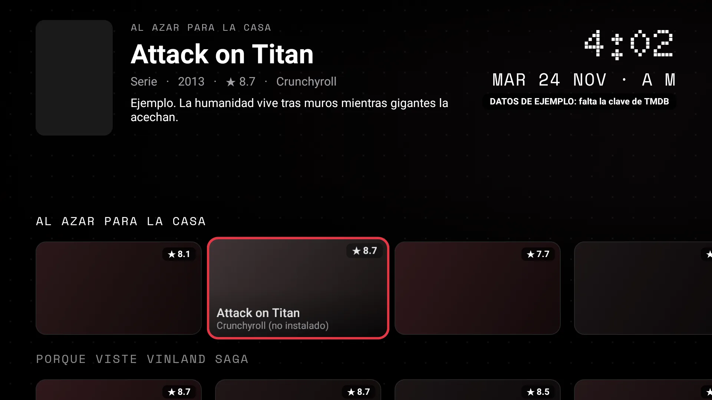
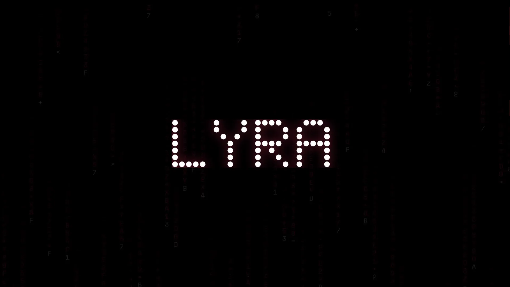
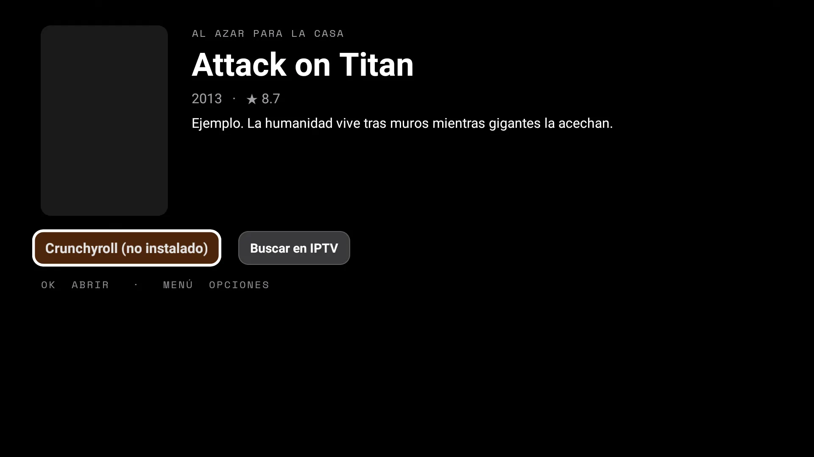
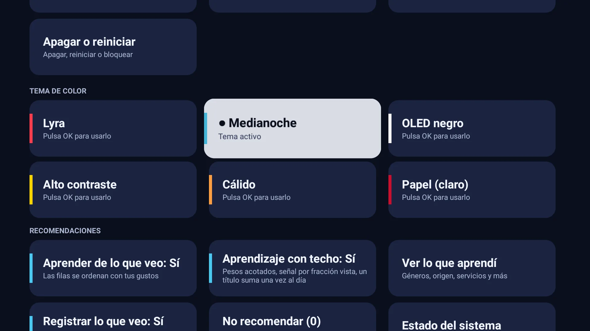
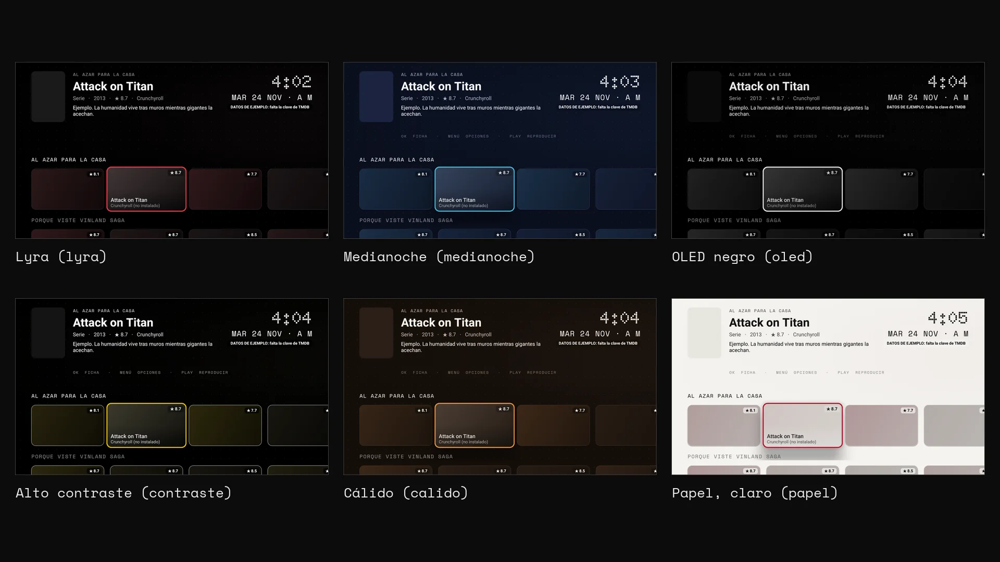

# Lyra — a quiet home screen for Fire TV and Android TV

[](LICENSE)

Lyra is an open-source launcher (home screen) for TV devices, written in Kotlin with Jetpack Compose. It replaces the ad-heavy stock home with a quiet, remote-friendly screen built around what you actually watch. It is built and tested on a Fire TV Stick 4K Max (Fire OS 7); it is designed for Fire TV and Android TV / Google TV devices (Android 9 or later, leanback).



<sub>Screenshots come from the Android TV emulator (Android 9) with the built-in sample data, which is what you see before adding a TMDB key. With a key, cards show real posters and backdrops.</sub>

> Spanish summary below / Resumen en español más abajo. Step-by-step install guide for non-developers: [INSTALL.md](INSTALL.md) (English) · [INSTALL.es.md](INSTALL.es.md) (Español).

## Quick start

1. On the TV, turn on *Developer options > Install unknown apps* for the **Downloader** app (Fire TV: *Settings > My Fire TV > Developer options*).
2. Open Downloader and enter: `https://github.com/Danvegamo/lyra-tv-launcher/releases/latest/download/lyra-tv-launcher.apk`, then install.
3. Open **Lyra** from your apps. Without a TMDB key it shows sample rows; get a free key and add it as described in [INSTALL.md](INSTALL.md#5-add-your-api-keys).
4. Making it your home screen is a separate step and depends on the device: see [INSTALL.md](INSTALL.md#4-make-lyra-your-home-screen).

That download link always points to the newest release: every release ships the same APK twice, as `lyra-tv-launcher-<version>.apk` (to keep a specific version) and as `lyra-tv-launcher.apk` (the stable name behind `releases/latest/download/`).

## Screenshots

| | |
| --- | --- |
|  |  |
| Intro, played while the TV wakes up | Title detail: OK on a card, then "Watch on…" |
|  |  |
| Settings (*Ajustes*) with the color theme picker | The six built-in themes |

## Features

- **Trending this week** in your country, filtered to the streaming apps you have installed (data from TMDB and JustWatch).
- **Recommendation rows that learn on the device**: "Because you watched…", genre rows, critically acclaimed picks. No account, no cloud: learning stays on the TV.
- **Continue watching**, My List, "Already seen" and "Don't recommend".
- **Search** with its own on-screen keyboard, also by actor or director.
- **Per-title menu** (☰ key on the remote): trailer (played inside the launcher), mark as seen, don't recommend, add to My List.
- **Guided search**: types the title into the search box of Crunchyroll, HBO Max, Prime Video, Netflix, YouTube (SmartTube) or an IPTV player, using an optional accessibility service.
- **Home button takeover**: an optional accessibility service brings you back to this launcher when Fire OS shows the Amazon home.
- **Nightly maintenance** (optional): at 4:30, if nobody is watching, trims caches and reboots the TV over local adb to keep it fast.
- **Explicit content filter** editable in `datos/bloqueo.json`.
- **Color themes**: six presets (including OLED black, high contrast and a light theme) picked with the remote, plus your own accent and background color. See [Themes & colors](#themes--colors).
- Optional: send viewing events to your own server, and mark finished anime episodes on AniList.

## Requirements

- A **Fire TV** device (tested on Fire TV Stick 4K Max, Fire OS 7) or an **Android TV / Google TV** device with Android 9 (API 28) or later. The Fire-specific parts (Home-button takeover, nightly maintenance) are only built for Fire OS; on Android TV the launcher itself runs, but that is untested.
- To build it yourself: **JDK 17+** (JDK 21 recommended), the **Android SDK** and **adb**.
- A free **TMDB API key**: <https://www.themoviedb.org/settings/api>. Without it the launcher only shows sample rows.
- To use adb on a Fire TV: *Settings > My Fire TV > Developer options > ADB debugging*. Find the TV's IP in *Settings > My Fire TV > About > Network*. (If Developer options is hidden, open *About* and click the device name 7 times.)

## 1. Configure

```powershell
git clone https://github.com/Danvegamo/lyra-tv-launcher.git
cd lyra-tv-launcher
Copy-Item config.example.properties config.local.properties   # macOS/Linux: cp config.example.properties config.local.properties
```

Edit `config.local.properties` (it is git-ignored and never leaves your machine):

| Key | Required | What it does |
| --- | --- | --- |
| `TMDB_API_KEY` | one of the two | TMDB v3 API key. |
| `TMDB_READ_TOKEN` | one of the two | TMDB v4 read access token (starts with `eyJ`). |
| `EVENTOS_URL` | no | HTTP endpoint of your own events server. Empty = events stay in a local queue on the TV. |
| `EVENTOS_TOKEN` | no | Bearer token sent to `EVENTOS_URL`. |
| `EVENTOS_DISPOSITIVO` | no | Device name reported to the server (default `firetv`). |
| `ANILIST_TOKEN` | no | AniList token. Not compiled in: push it to the TV (see *Optional*). |
| `THEME` | no | Default color theme: `lyra`, `medianoche`, `oled`, `contraste`, `calido` or `papel`. See [Themes & colors](#themes--colors). |
| `THEME_ACCENT`, `THEME_BACKGROUND` | no | Custom accent and background as `#RRGGBB`. |

If `EVENTOS_URL` is plain `http://` on your LAN, add its host to `app/src/main/res/xml/red_segura.xml`; everything else must be HTTPS.

**Your taste profile (optional).** Copy `datos/gustos.example.json` to `datos/gustos.json` and edit it:

- `region` / `idioma`: country (e.g. `US`, `CO`) and language (e.g. `en-US`, `es-MX`) for TMDB and JustWatch.
- `proveedores`: your streaming apps (TMDB provider ids, Android package, optional search URL with `{q}`).
- `declarados`: genres and themes you like, and a minimum rating.
- `anclas`: titles you love; "Because you watched…" rows start from them.
- `filas`: the rows on the home screen.

Without `datos/gustos.json` the launcher uses the example as is. `datos/gustos.json` is git-ignored.

## 2. Build

```powershell
.\gradlew.bat assembleDebug          # macOS/Linux: ./gradlew assembleDebug
```

The APK ends up in `app/build/outputs/apk/debug/app-debug.apk`. Run the unit tests with `.\gradlew.bat testDebugUnitTest` (or `scripts\pruebas.ps1`).

If Gradle cannot find the SDK, set `ANDROID_HOME` or create a `local.properties` with `sdk.dir=<path to your Android SDK>` (git-ignored).

> An APK you build with a key in `config.local.properties` contains that key. Share the source, not that APK. The published release APK has no key.

## 3. Install on the TV

Windows (recommended, it re-enables the accessibility service that `adb install -r` disables):

```powershell
.\instalar.ps1 -Tele <tv-ip>                       # your Fire TV IP address
.\instalar.ps1 -Tele <tv-ip> -Apk path\to\app.apk  # a different APK
```

Any OS, by hand:

```sh
adb connect <tv-ip>:5555
adb install -r app/build/outputs/apk/debug/app-debug.apk
adb shell settings put secure enabled_accessibility_services co.davidvega.launcher/co.davidvega.launcher.sistema.HomeAccessibilityService
adb shell settings put secure accessibility_enabled 1
adb shell pm grant co.davidvega.launcher android.permission.WRITE_SECURE_SETTINGS
```

Then press Home on the remote and pick **Lyra** if asked. Do not use "Force stop" on the launcher: Fire OS revokes its accessibility permission; reinstall with the script if that happens. *Ajustes > Estado del sistema* (Settings > System status) inside the launcher shows what works and how to fix what doesn't.

## Customize

- **Apps and tiles.** The app row and "Watch on…" come from `proveedores` in `datos/gustos.json`. Example:
  ```json
  "netflix": { "nombre": "Netflix", "ids": [8], "paquete": "com.netflix.ninja", "busqueda": "https://www.netflix.com/search?q={q}" }
  ```
  Without `busqueda`, the launcher opens the app and copies the title. If a profile exists in `datos/perfiles_busqueda.json`, it types it for you.
- **IPTV player.** Set the package of your IPTV app in `Abrir.IPTV` (`app/src/main/java/co/davidvega/launcher/sistema/Abrir.kt`), and replace `com.example.iptv` in `datos/perfiles_busqueda.json` and `app/src/main/res/xml/servicio_accesibilidad.xml`.
- **Order of apps by usage.** `python uso_apps.py --ip <tv-ip> --empujar` reads app usage over adb and pushes `uso_apps.json` to the launcher.
- **Edit without rebuilding.** `gustos.json`, `perfiles_busqueda.json`, `bloqueo.json` and `config.local.properties` can be pushed to `/sdcard/Android/data/co.davidvega.launcher/files/`; the launcher prefers them over the bundled copies.
- **Branding.** Name in `app/src/main/res/values/strings.xml`, intro video in `app/src/main/res/raw/intro_vigia.mp4`, banner and icon in `app/src/main/res/drawable-*`.
- **Application id.** To install side by side with someone else's build, change `applicationId` in `app/build.gradle.kts`.

## Themes & colors

Lyra ships six color themes. Pick one with the remote in *Ajustes > Tema de color* (Settings > Color theme): move to a theme and press OK. The change is immediate and is saved on the TV, so it survives restarts and updates.

| Theme | Id | Look |
| --- | --- | --- |
| Lyra | `lyra` | Default. Black and white, red focus ring. |
| Medianoche | `medianoche` | Deep navy with a cyan accent. |
| OLED negro | `oled` | Pure black surfaces and a white focus ring, for OLED TVs and dark rooms. |
| Alto contraste | `contraste` | Black, white and a yellow focus ring and buttons. Not customizable, on purpose. |
| Cálido | `calido` | Warm dark brown with an amber accent. |
| Papel | `papel` | Light theme: off-white background, dark text, crimson focus ring. Text shadows are turned off. |


**Custom colors.** Add any of these to `config.local.properties`, either before building or in the copy you push to `/sdcard/Android/data/co.davidvega.launcher/files/` (then restart Lyra):

```properties
THEME=medianoche          # default theme when none was picked in Ajustes
THEME_ACCENT=#4CC9F0      # focus ring and highlights
THEME_BACKGROUND=#101820  # background; cards and borders are derived from it
```

A theme picked in *Ajustes* wins over `THEME`. The custom accent and background are applied on top of whichever theme is active, except *Alto contraste*.

**Accessibility rules.** Every built-in theme meets WCAG 2.1 AA: at least 4.5:1 for all text on the background and on cards, and at least 3:1 for the focus ring and the focused card against the background, so the D-pad focus is always visible. Custom colors are checked with the same rules: an accent below 3:1 or a background that would push any text below 4.5:1 is ignored, the reason is logged (`adb logcat -s Launcher`, lines starting with `tema:`) and shown under the theme picker. The rules live in `app/src/main/java/co/davidvega/launcher/data/Temas.kt` and are covered by `TemasTest`.

## Optional

- **AniList.** Put `ANILIST_TOKEN=...` in a `config.local.properties` and `adb push` it to `/sdcard/Android/data/co.davidvega.launcher/files/`.
- **Nightly maintenance.** Authorize once in *Ajustes > Autorizar mantenimiento* (accept "Always allow" on the adb prompt). Turn it off in *Ajustes > Mantenimiento nocturno*. It relies on network adb staying enabled on the TV.

## Uninstall / revert

```sh
adb shell settings put secure enabled_accessibility_services ""
adb uninstall co.davidvega.launcher
```

Fire OS goes back to the Amazon home immediately. Nothing else on the TV is changed by the launcher.

## Español

**Lyra** es una pantalla de inicio de código abierto para Fire TV y Android TV: tendencias de la semana en tus apps, filas de recomendaciones que aprenden en el aparato, «Seguir viendo», Mi lista, buscador con teclado propio y búsqueda guiada en Crunchyroll, HBO Max, Prime Video, Netflix, SmartTube o tu app de IPTV. Se probó en un Fire TV Stick 4K Max (Fire OS 7).

**Inicio rápido:** guía paso a paso para quien no programa en [INSTALL.es.md](INSTALL.es.md). Resumen: instala la app **Downloader** en la tele, activa «Instalar apps desconocidas», escribe `https://github.com/Danvegamo/lyra-tv-launcher/releases/latest/download/lyra-tv-launcher.apk`, instala y abre **Lyra**. Sin clave de TMDB solo muestra filas de ejemplo.

Desde el código:

1. **Configura:** copia `config.example.properties` como `config.local.properties` y pon tu clave gratuita de TMDB (`TMDB_API_KEY` o `TMDB_READ_TOKEN`). Lo demás es opcional. Si quieres, copia `datos/gustos.example.json` como `datos/gustos.json` y ajusta región, idioma, apps, gustos y filas.
2. **Compila:** `.\gradlew.bat assembleDebug` (JDK 17+ y Android SDK).
3. **Instala:** activa la depuración ADB en el Fire TV y ejecuta `.\instalar.ps1 -Tele <IP-de-tu-tele>`. Pulsa Home y elige «Lyra».
4. **Desinstala:** `adb uninstall co.davidvega.launcher`; el Fire TV vuelve al inicio de Amazon.

**Temas de color:** seis temas (Lyra, Medianoche, OLED negro, Alto contraste, Cálido y Papel, el claro) en *Ajustes > Tema de color*, más acento y fondo propios con `THEME_ACCENT` y `THEME_BACKGROUND` en `config.local.properties`. Todos cumplen el contraste WCAG AA y los colores propios que no lo cumplan se ignoran. Detalle en [Themes & colors](#themes--colors) y en [INSTALL.es.md](INSTALL.es.md#6-colores-y-temas).

El código y los comentarios están en español. Las contribuciones son bienvenidas en inglés o en español (ver `CONTRIBUTING.md`).

## License

[GPL-3.0](LICENSE) (GNU General Public License v3.0). Lyra links [NewPipeExtractor](https://github.com/TeamNewPipe/NewPipeExtractor) (GPL-3.0) to play trailers, and the project is licensed accordingly. Bundled fonts (Doto, Space Mono) are under the SIL Open Font License.

## Trademarks

Lyra is an independent project and is not affiliated with, endorsed by or sponsored by Amazon, Google, Netflix, TMDB, JustWatch or any streaming service. "Fire TV", "Fire OS", "Android TV", "Google TV", "Prime Video" and other names are trademarks of their respective owners and are used here only to describe compatibility. This product uses the TMDB API but is not endorsed or certified by TMDB.
